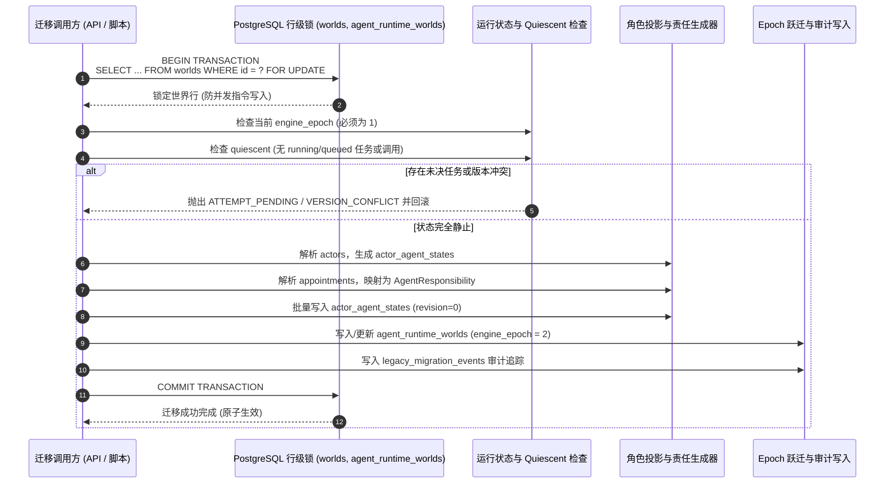

# 旧存档（Epoch 1）接管与可控迁移技术规范

## 1. 背景与目标

新架构（Epoch 2：Actor Agent Runtime 与 Narrative Handoff）已在正式玩家新建世界（Task 44-119）与试演恢复（Task 44-120）中实现闭环并部署上线。
为了让历史玩家存档在合适时机安全过渡到新架构，必须建立可重复、可中断、可核查的旧存档接管机制。

**核心红线**：
1. **真实档案与虚构世界隔离**：绝不破坏或覆盖既有历史事实；
2. **禁止假造与脑补**：未在旧存档发生过的事情必须保持“未知”，不得凭空伪造 NPC 的私密目标或未履行的诺言；
3. **单向不可逆跃迁（前向恢复）**：迁移前支持干净放弃；一旦进入 Epoch 2 产生新事实或新回执，系统必须坚持前向恢复，严禁强行回退到 Epoch 1 导致数据混跑或状态截断；
4. **零破坏与防双写**：迁移全过程在单个行级锁事务中完成，迁移期间杜绝旧引擎与新引擎同时写入；
5. **合成数据先行**：所有逻辑首先在合成旧存档上进行全量测试验证，严禁直接在生产真实玩家存档上动刀。

---

## 2. 旧存档（Epoch 1）数据资产盘点与映射矩阵

| 数据资产类别 | Epoch 1 存储形态 | Epoch 2 承接形态 | 迁移策略与已知/未知边界 |
|---|---|---|---|
| **角色基础档案 (Actors)** | `worlds.state.actors`（包含 id, name, persona 等） | `actor_agent_states` | **可靠迁移**：提取角色身份基线 `definitionRef = actor.id`；**未知边界**：心理活动、私密欲望、长远企图全部保持未知（`goals: []`, `plans: []`, `decisions: []`），不捏造历史心理。 |
| **聊天历史 (Messages)** | `worlds.state.messages` / `world_messages` | 保留原样，作为对话上下文只读依据 | **可靠迁移**：历史对话原样保留，`version` 与消息时间序不可变。新引擎以只读方式引用为对话上下文。 |
| **世界时钟 (World Clock)** | `world_clock` / `worlds.state.time` | `world_clock` | **可靠迁移**：保留当前时刻、现实时间锚点（`baseRealMs`）、流速倍率（12x / 1x）与暂停状态。 |
| **约定日程 (Appointments)** | `world_appointments` / `worlds.state.appointments` | `AgentResponsibility`（`subject.kind = 'appointment'`） | **可靠迁移**：将涉及各角色的有效预约提取为对应角色的显式责任（`status: 'open'`, `waitingOn: 'world' | 'player'`）；**未知边界**：未定时间的随口闲聊不升级为约定。 |
| **地点与笔记 (Places & Notes)** | `worlds.state.places`, `world_notes`, `world_facts` | 保留于世界状态，作为环境只读上下文 | **可靠迁移**：已探索地点与笔记事实原样保留。角色未明确初始位置的标记为未知，不伪造在场。 |
| **未决事件 (Unplayed Events)** | 编剧发布作品中的剧情节点 | `agent_episode_requests`（未来由导演按需挂载） | **必须保留未知**：旧存档中未触发的事件不得在迁移时刻批量灌入；保持未触发状态，由导演在后续运行中依据真实条件评估。 |
| **素材与照片 (Media & Photos)** | `world_album`, `assets` | 保留原表引用 | **可靠迁移**：媒体资产引用只读继承，不重复生成、不篡改归属。 |

---

## 3. 迁移执行流程与防双写机制

迁移操作通过单事务函数 `migrateLegacyWorldInTransaction` 实现：

---

## 4. 回滚与前向恢复边界

1. **迁移前与迁移瞬时失败**：
   - 若迁移事务抛出任何异常，数据库由于 ACID 特性自动全量回滚，世界仍然保持在 Epoch 1，数据零改动，旧引擎可无缝继续运行。
2. **迁移成功但未产生新数据**：
   - 若管理层在迁移完成后且在**任何玩家指令或模型交互发生前**决定取消，可将 `engine_epoch` 重置为 1 并清理空的 `actor_agent_states`。
3. **已产生 Epoch 2 新事实（不可逆边界）**：
   - 一旦在 Epoch 2 中产生了新消息、新事件、新回执（`agent_attempts`、`agent_input_receipts`、`actor_agent_states.revision > 0`），**严禁粗暴切回 Epoch 1**。
   - 若此时强行切回，会导致新引擎写入的事件和状态在旧引擎中无法识别，造成致命的状态错乱或死锁。所有后续异常必须遵循 Task 44-120 的前向恢复（查询回执、幂等重放、显式标记失败），而不是回退引擎版本。

---

## 5. 合成旧存档验证计划

在真实测试 PostgreSQL 数据库（端口 55432，`parallel_life_test`）上构造包含以下特征的合成旧存档：
- `version = 3`（非零版本，已有数轮历史演进）；
- 2 名 NPC 角色与 1 名玩家角色；
- 5 条真实历史私聊消息；
- 1 项未过期的预约日程（`appointment`）；
- 2 个探索地点与 1 条随手笔记；
- 时钟处于流逝状态。

验收测试项：
1. **完整性**：历史消息、地点、时钟、笔记完全无损；
2. **状态纯洁性**：NPC 心理欲望保持为空，预约日程正确挂载为 `AgentResponsibility`；
3. **并发阻断**：模拟处于 `running` 状态的任务时，迁移被立即拦截（`ATTEMPT_PENDING`）；
4. **幂等重放**：对已完成迁移的世界重复调用迁移，平稳幂等返回；
5. **后续推进**：迁移后以 Epoch 2 执行玩家指令与状态更新，版本递增平稳；
6. **逆向防护**：拦截非法降级 Epoch。
