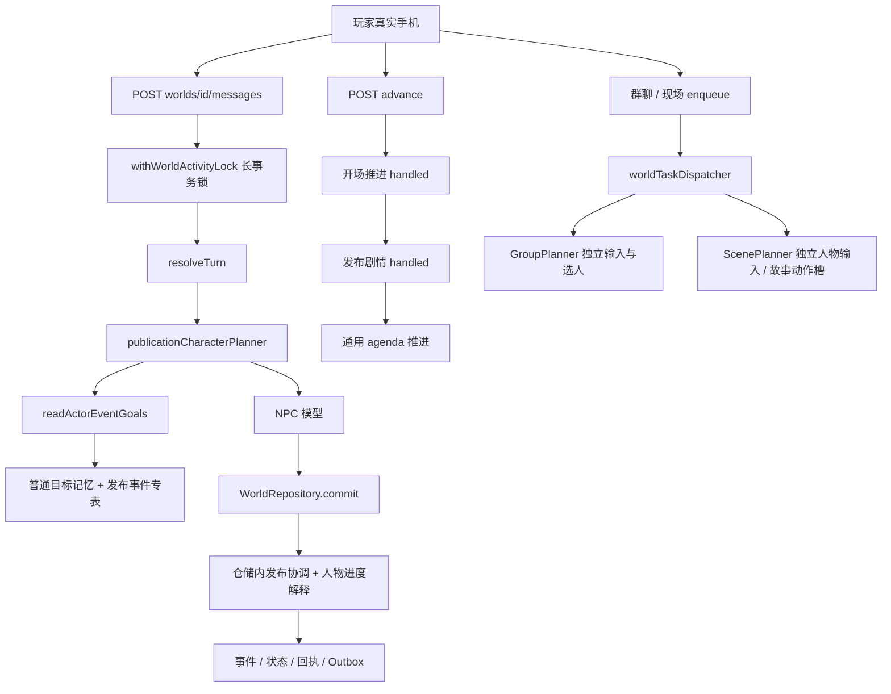
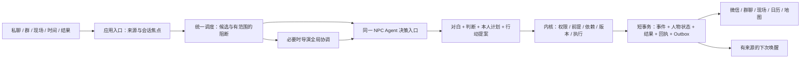
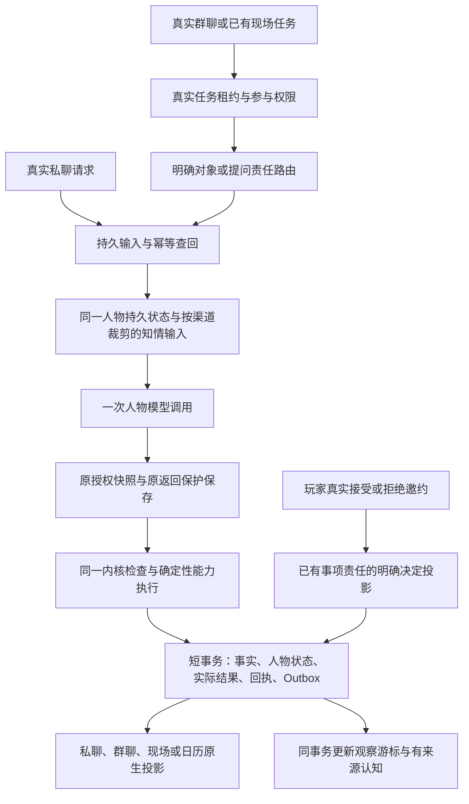
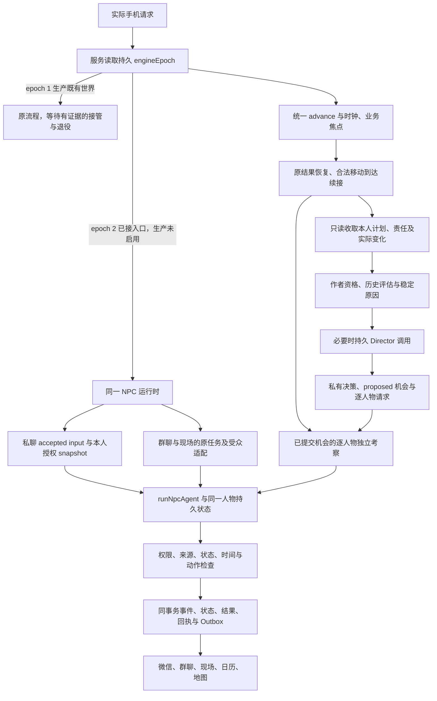

# 持续人物 Agent 与导演总控：运行架构和迁移方案

最新实施接续：阶段七的实际移动、发布证据及剩余边界见本文末尾；初始调用图是审查基线，不是现在线上所有入口。

2026-10-15；集成人 codex-root-ma-arch44-i。审查基线 `1028b06b`，主目录 `96e51d15` 不作为源码基线。本文是实施契约和验收计划，**不是已实现声明**。唯一任务状态在主登记目录 `docs/DEVELOPMENT.md`。

## 1. 当前实际运行图

以下来自实际路由/服务/Worker，而非早期 ARCHITECTURE.md 的理想队列图。

实际细节：

- 私聊并未先进入 world Worker；路由直接运行 `resolveTurn`。`services.characterPlannerFor` 和 `publication-character-planner.ts` 提供本人设定、目标、开场记录。不能说现在完全没有人物隔离和持久目标。
- `services.ts:239–289` 顺序调用 opening、publication、generic；前两者 handled 时提前返回。发布池存在但无候选也 handled，因此普通约定没有参与这次调度。
- `readActorEventGoals → publicationGoalContexts` 在上下文读取时初始化/补写进度。`PostgresWorldRepository.commit` 又调用发布仓储协调和人物进度应用，保存层承担业务解释。
- 群聊由 `planGroupTurn → GroupPlanner`；现场由 scene task handler/ScenePlanner。不是统一人物决策入口。群消息和私聊来源表不同，普通目标读取只认可私聊来源。
- `ClockStore.withAdvanceLock` 在 BEGIN/事务 advisory lock 内等待模型；外层事务并不能回滚内层别的连接已经提交的结果。
- 43 已修来源绑定、部分开场可记进度、个人/共享阶段分离和多人开场计数膨胀；这些不重复修。剩余计数驱动收尾、候选/领取口径以及双轨状态仍须替换。
- 原稿、历史消息/朋友圈/图片、地图、日历投影及玩家独立世界已存在；重构不能重生这些内容或重置存档。

## 2. 目标边界和真实入口

所有渠道调用同一 `NpcAgentRuntime.decide`，身份为 `(worldId, actorId)`。共用模型/代码，按条件唤醒，不要求每 NPC 常驻进程。导演和人物使用不同权限的快照。

|组件|唯一职责|不能做|
|---|---|---|
|NpcAgentRuntime|读取本人持续状态与获准观察；一次调用提出表达、判断、计划调整及行动|直接写事实/数据库，替玩家答应，看到他人私聊/幕后全部内容|
|DirectorRuntime|全局虚构观察、人物计划摘要、冲突与因果；引入/延后事件、调度节拍与人物机会|替人物决定私人态度、最终台词，忽略玩家选择，凭空宣布动作完成|
|WorldKernel|验证身份/来源/知情/时间/地点/归属/前提，执行合法动作，产生真实结果|以对白、摘要、模型自称成功当执行证明|
|ChannelAdapter|授权本次观察、受众、回复对象、允许动作；投影同一执行结果|自建另一套人物目标、复制私人原话到群里、单凭消息数结账|
|Application coordinator|领取、模型调用、校验、短事务提交、故障恢复和唤醒|把业务选人/协调藏在仓储读取中|
|Repository / UoW|持久存取、CAS、锁和事务原子性|决定人物动机、选谁说话、吞掉另一来源候选|

导演介入：引入新大事件、跨人物计划冲突、共享事件发生实质变化、长期合法静默后需要重新编排。确定性单人承接可沿已批准协调方案执行，不给每条消息串行增加一次导演模型。导演输出协调意图/资源限制/优先候选及理由，人物自己决定回应和私人计划。

## 3. 持久对象与所有权

公共契约归集成人；领域类型位于 `world/domain/agent-runtime.ts`，应用端口位于 `world/application/agent-runtime-ports.ts`。新增持久对象必须带 schemaVersion、来源、版本和归属，禁止只加 prompt actorId 宣称完成。

|对象|身份和核心字段|维护方式|
|---|---|---|
|ActorAgentState|worldId/actorId/revision、人物定义版本、可见事实/记忆/关系引用、goalIds、planIds、waitingIds、responsibilityIds、投影游标|人物提出变化；内核验证并与事件同事务提交|
|Goal|ownerActorId、来源、目标结果、active/deferred/fulfilled/withdrawn及终止原因|该人物提出；fulfilled 必须指向实际结果，不以消息数结束|
|Plan|goalId、下一步 actionId、触发条件、缺失条件/重查依据、原计划版本与修改历史|人物自行调整；导演仅提供协调约束|
|Action|ownerActorId、类型/对象/前提、执行状态、输入版本、依赖与结果引用|内核执行器；proposed/ready/waiting/blocked/executing/succeeded/failed/withdrawn 分开|
|Responsibility|谁对哪个 request/事项负责、等待谁、答复窗口来源、何时视为已处理|只由具体行动/结果回执处理；天气聊天不能消费赴约责任|
|PlayerDecision|实际输入 source、目标 request/事项版本、accepted/declined/negotiating/deferred/undecided|同一次 NPC 模型提出判断；来源和对象验证；不确定保持待定|
|SharedEpisode|参与人、实际事实、事件状态、未完责任、因果和终止原因|世界内核维护；导演提议引入、协调，不混为某人退出或当前话题结束|
|ConversationFocus|渠道/thread、提问者、回复对象、当前事项和开放问题|由实际交互更新；换话题不会关闭旧事件|
|ActionResult|实际执行能力/对象、发生时间、因果前置、成功或失败、已处理责任|内核唯一权威，和人物信念/语言/计划分别保存|
|AgentAttempt|幂等 key、world/actor/episode 版本、输入指纹、token、调用/响应/校验/提交状态|应用协调和任务基础设施，不与行动成功混用|

来源 `SourceRef` 统一支持私聊、群消息、现场条目、世界事件、动作结果、作者定义。内核解析真实对象及成功回执，核对世界/人物/受众/时点/版本/忘记规则；模型只引用服务器给的有限来源。人物可以在私聊中改变自己的计划，群里据此行动，但不自动获得披露私人原话/秘密的权限。

事件与焦点严格分离：推进有新选择/事实/执行结果；修改保留目标和历史；新事件有独立来源；换话题只换焦点；暂缓记录缺失条件；结束保存完成/拒绝/撤回/合法到期等原因。沉默不是拒绝，没有合法来源的截止时间不生成。

## 4. 调度、交谈和时间

各来源只读提供 `Candidate[] + Blocker[]`，而非 handled 提前返回。来源为开场、编剧事件、人物计划、日历责任、现场/群消息、已提交行动结果。阻断必须带 world/actor/episode/channel/action/resource 范围、原因、来源及解除依据。开场B的交付unknown只挡B该次行动及依赖它的候选，不能挡同事件已交付A的早回复。开场导演计划unknown只挡依赖该计划的候选；只有会影响全局原子性的阻断才冻结世界。冲突检查使用共享资源/读集，不能用同episode一刀切。

先由代码核权限、前提、时间、地点、频率、是否已有执行或未决请求，再按实际回复对象/责任/优先级选择。群聊优先明确 @/reply-to，再开放问题提问者与事项负责人；歧义保留，不用数组第一人或全员回复。导演介入语义冲突时观察同一份候选快照；领取和实际执行消费相同版本，版本变化重验，不能换口径。

事件进度只看实际事实/选择/结果；人物目标进度看本人的目标变化；消息数仅用于联系频率。安静必须可说明为未到触发/缺少条件/已等待/没有值得呈现的变化，不能用来掩盖无法执行的计划。

时钟继续采用浏览12倍、交谈/现场1倍、60–90秒便宜检查、离开暂停与明确返回。交谈为带tab/成员授权、会话focus token、opened/left/ended和presence的业务会话，从打开真实对话/现场到离开或明确结束，不以30秒没打字恢复12倍。阅读和思考仍属于交谈。多tab取有效前台会话最慢速度（有chat则1倍），失联租约到期后退出会话/暂停，不推算离线进度。定时检查与 DOM 滚动/点击解耦；检查不保证模型调用或新事件。多标签租约和暂停权益继续生效。

等待跳到下一有意义边界：约定前、明早等；遇到直接影响选择的变化先停下。未回应邀请按具体责任/合法窗口处理，不把所有 proposed 邀约变成全局永久阻断。玩家明确暂缓可绕过已展示的选择，但保留后果和责任。旧存档从当前锚点继续，不折算过去离线时间。

## 5. 执行、依赖与恢复

1. 短事务领取：权限/预算/时间/版本/幂等检查，保存输入快照摘要、attempt、token、engineEpoch和租约；提交释放连接。epoch是数据库控制面fence，claim、响应保存、commit均核对；所有旧writer最终事务同样受fence约束，不能只有路由feature flag。
2. 事务外调用模型。普通人物一轮完成对白、必要判断和有限行动提议。记忆摘要异步，不能替代事实/执行状态。
3. 收到结果先保存受保护的可恢复响应；不写原始内容到日志。严格解析、来源与依赖校验。
4. 短事务提交：核 token、world/actor/episode 版本和前提；事件、人物状态、执行结果、回执、Outbox 一次提交。晚到响应不能覆盖较新状态。
5. 投影手机各渠道和安排来源明确的后续唤醒；查询不隐式推进。

attempt 分 reserved/request_sent/response_received/invalid_output/stale_discarded/committed/cancelled_before_send/unknown_after_send。已知坏输出与已知版本冲突不标 unknown；发出后结果未知不自动重付。HTTP 重放先查原回执，重新推理必须是明确的新尝试。移除长事务必须在持久领取和CAS已就位后进行。

对白带所依赖的行动提案 ID。独立有效对白可保留；依赖无效/未执行动作成功的对白不能显示。人物“我会去处理”可作为计划表达，不能生成“已经处理”结果；世界到场由空间/参与能力执行，而不是接受邀约或一句“会来”。

## 6. 保留、合并、替换、删除

|处置|范围|
|---|---|
|保留|世界事件/reducer、RLS/所有权、命令回执、Outbox、来源/forget/时点保护、开场实际收据、真实历史/素材、地图/日历执行能力、时间锚点与多标签租约、多人授权边界|
|合并|普通目标与发布人物进度→统一人物/事件状态；私/群/现场来源→SourceRef；开场/编剧候选/普通责任→统一调度集合|
|替换|三个渠道的独立人物输入/模型决策入口；仓储选人和协调；context read隐写；任意后续消息消费责任；计数驱动收尾；模型期长事务锁|
|删除|完成切换后的串行 handled 调度、goal-memory执行JSON读写、重复进度解释器、核心Planner中的R17动作槽及固定句式；过期兼容入口不得继续执行|
|内容迁移|R17专属对象/规则放入对应世界的显式能力实例/规则包。通用 handover/inspect 能力由内核验证授权对象、存在和证据，不从自然对白正则推断执行|

保留旧事件重放读取器不等于保留旧运行引擎。每个世界同一时刻只能一个引擎写执行结果，不能双写同步两份目标。

## 7. 存档迁移与回滚

- 新增 schema/engineVersion/迁移游标；先不改原历史和时钟。授权虚构人物生成独立 state；作者版本为不可变引用，不覆盖导入全文、预制消息/朋友圈/图片。
- 只从真实事件/成功回执/有效结构化选择重建目标、责任和结果。旧内部进度JSON只在来源/hash有效时映射；没有标注的历史保持 unknown，不另调模型猜过去的答应或拒绝。
- 只读 shadow 比较状态，不调用模型、不发消息、不执行动作。迁移有 provenance、游标及幂等，逐世界原子切换。
- 旧存档保留 worldId、版本、历史、素材、地点、时间锚点、约定和已发生结果。多人共享实例和成员授权不能合并到某个玩家私有身份里；人生间不共享人物私有状态。
- 切换前可撤回新增投影；切换后如果已产生新动作，不允许直接回到不认识新结果的旧调度器。暂停执行、修复/重放新投影；只有旧内核能完整读取新事件并核对责任时才允许回切。不得回滚用户已作决定或恢复重复收费机会。

## 8. 分期与最终验收

|任务|依赖|实现和退出标准|
|---|---|---|
|44-0 架构|最新三方只读审查|本调用图、协议、状态所有权、替换/迁移/恢复经交叉审查；只完成文档不称业务完成|
|44-1 状态与执行内核|44-0|typed agent/goal/plan/action/responsibility/decision/source；显式投影；持久attempt和短事务CAS；真实PG权限/并发/晚结果/回放/回滚通过|
|44-2 人物统一入口|44-1|私聊/开场/群/现场实际流量使用同一人物状态和决策；渠道裁剪；群短答责任；一次人物调用；替换旧状态解释|
|44-3 统一导演与自主调度|44-1/2|候选来源统一、范围阻断、导演全局语义协调、结构化本人行动/等待结果、沉默/拒绝不同路径，删除串行调度和计数结局|
|44-4 时间与内容解耦|44-2/3|业务交谈生命周期/闲时检查/重要等待；R17实例移出核心；新题材不用改Planner|
|44-5 迁移清理与产品验收|44-1至4|旧存档迁移、全部执行入口切换、重复写路径删除；真实连续旅程、生产迁移、READY、公网验证|

最终连续旅程（每项记录实际状态/来源/玩家可见后果）：进入自然开场；未全部开场时记住早回复；同一人物私聊→群→现场目标连续/不泄密；甲提问玩家短答由甲承接；天气聊天不消掉约定；答应/拒绝/协商/暂缓/沉默各有区别；空闲有合法变化且不硬造；等待重要变化停下；同事项不反复催、不按消息数收尾；换题材不改通用动作；多标签/并发/晚到/unknown不重执行；旧历史/时间/约定/素材不丢。

代码执行 check/build；SQL、权限和队列真实PG；手机/PC界面验证；真实模型只用新的明确范围，不复用已闭账43。每批业务交付先核生产迁移再提交推送、READY和公网流程验证。未走完上述旅程，状态保持阶段完成/整体未完成，不以类、目录、API200或测试数量替代验收。

## 9. 首批实施边界

当前实际代码与验证见[44-I报告](../task-reports/MA-ARCH-44-I.md)。已落持久人物状态、输入/attempt/结果、epoch围栏、原授权快照与原返回恢复、viewState授权闭包、统一模型协议与纯候选调度，真实私聊入口已接受控新内核。生产world不自动切epoch2；群/现场/真实候选collector/持久导演及旧存档迁移仍未完成，不将此阶段称为完整多Agent架构。

执行补充：玩家决定按责任版本和实际来源先后判断，旧答应不能覆盖后拒绝。普通成功结果不自动完成目标，只有可信能力结果completedGoalIds认证；记计划和提出邀请没有外部目标完成资格。输入原storyAt与当前执行storyAt分开；恢复解析原保护快照，最终重新验证权限、来源、时间及版本，不拿新上下文解释旧返回。模型view的源授权、依赖及等待闭包收敛，完整canonical状态保留在服务器，查询本身不更新进度。

## 10. 有界创作、可观察性与持续导演观察（用户补充，同一44架构）

此节与前述同一NPC state、Kernel、Director和epoch切换共用协议，禁止另建“活跃助手”或第二套推戏路径。现生产epoch1不因本文自动获得这些能力。

### 10.1 世界边界与权限

WorldBoundary保存已有actorIds、placeIds、活动与已注册能力、可变化的关系/安排/结果类型，以及有来源的扩展授权。默认不允许新增城市、重要人物、身份体系或重大背景转折。编剧事件是素材而非封闭剧本：导演可在边界内提议机会、新请求、已有计划交叉与选择后果，但不能把机会当事件已经发生，不能批量替人物决定私人态度。超能力提案返回明确unsupported结果与当前可用能力，不为所有NPC写统一拒绝台词。人物的愿意/不愿意是本人判断，产品的可执行/不可执行是Kernel资格，两者分别保存。

### 10.2 时空真值与人物认知的所有权

|对象|所有权|依据与可见范围|
|---|---|---|
|World instant|现有world clock与Kernel|UTC瞬时+世界时区，统一代码换算当地日期时间；不是模型生成日期|
|AuthoritativePosition|Kernel执行结果/空间投影|player或actor的at/in_transit/unknown；出发、到达和版本来源分别记录，contactActorIds不是实际位置|
|ActorPositionKnowledge|同一人物Agent的有来源观察投影|主体、最后已知位置/离开/未在、事件发生时刻(可未知)、learnedAt、direct/player_report/relayed/inference、source、可能过时；不能读取全地图再要求不用|
|Plan/decision window|既有AgentPlan/Responsibility|计划时间不同于实际时间；硬答复期限必须有来源；没有期限时保留下一重查依据而不造deadline|
|Director observation|世界全局虚构观察投影|observedThroughVersion与evaluatedThroughVersion分开；原事件/原话/人物自述/计划/执行结果分别关联，人物报告不是世界真值|

位置传播链：实际动作提交 → 权限与在场/视线/明确告知规则 → 仅相关NPC获得观察 → 有来源唤醒候选 → 该NPC自行决定联系/等待/另作安排 → Kernel提交。妈妈/恋人/朋友身份不授予地图知情。看见离家只知离开起点，不自动知道目的地；15:40发现房间没人只知观察当时不在，不倒推15:30出门。玩家说“在咖啡馆”只形成有来源告知，不改变实际位置。未在场又未收到告知者保持未知。

### 10.3 导演触发与安静

每个实际提交事件都可更新全局观察游标，只有模型真正评估并持久提交编排后才能推进evaluated游标。明确决定、重要计划变化、执行结果、新资格成立、跨人物冲突可产生needsEvaluation原因；普通消息只更新可检索观察，不默认多调导演。75秒是廉价检查窗口，频率与12倍世界时钟独立；阅读和思考不等于无聊。

调度输入同时含最近实质变化、事件停滞依据、未承接行动/决定、当前交谈focus和待处理负担。合法输出包含quiet、continue、own_action、bounded_opportunity；不能为活跃制造事故/惩罚、无依据危机，不能在深入互动中持续用无关强制事项抢注意。新机会仍由相关人物自主参与，Kernel验证实际动作，扩展权限另行检查。

### 10.4 被冷落事项的去向

所有未完责任保留具体来源/当前决定/本人准备与实际位置/下一检查条件。A的赴约不把A私聊或玩家真位置传给B。B未被答应不记missed；B已被答应也不能猜玩家动机。合法时机唤醒B，由B依据自己的Persona、关系与目标提出理解、询问、撤回、等待、另作安排或暂不联系。无消息的决定仍保存计划/责任变更及理由；不实现统一“等→催→怒→离开”流程，不自动扣好感。

### 10.5 补充验收（必须真实入口，不只prompt/纯函数）

- A深入互动时B事项仍被合法重查；B安静调整后可追溯，不重复发同请求。
- B看不到A私聊/玩家真位置；目击者只获离开起点，未在场者未知；稍后观察缺席不倒推离开时刻。
- 告知/转述/推测/亲眼观察含不同来源性质和发生/获知时间，告知不提升世界位置真值。
- 导演观察游标持续更新但普通聊天零额外导演调用；待评估事实与已评估范围可区分。
- 导演在原有边界内提议机会，机会≠行动≠玩家同意；新城市/重要人物/重大设定变动无扩展授权拒绝执行。
- 12/1倍、75秒便宜检查、重要节点等待保护、离开暂停及旧锚点保持；重试/晚到/跨tab不重复执行和不重付。

实施：B独占0073及world-awareness域/存储，root负责共用snapshot/model/Kernel实际hook和公共契约，P只接旧玩家UoW，Q原生渠道投影/只读授权输入。状态归属与接口冻结后才接线，未接所有实际writer/模型旅程前不标完成。

## 11. 第二批真实入口与尚未切换的入口

以下是代码已接入的epoch2路径，生产尚无epoch2世界，不能将其写成全量切换完成：

实际调用：群聊任务与现场已有人物回合由worldTaskDispatcher的epoch2 handler进入nativeNpcTaskHandler，保留实际TaskLease/token；成功内核提交与父任务完成同SQL。群内短答先承接该群实际上一提问者，不按数组首人；路由确有歧义时显式等待导演协调，不伪造全员回复。人物私聊计划可作为本人跨渠道策略依据，私人原话不会作为群内公开观察。

原私聊成功回执、明确邀约按钮、地图旅行与场景实际presence是不同来源。locationReports仅建立有原消息逐字证据的player_report，不改变玩家实际位置；非收信人物保持未知。确定性环境展示不会把已有在场证明重写成新的移动事实。

导演保护调用、不可变决策、完整observed/evaluated游标比较和proposed-only共享情节已实现。quiet不创建假世界事件，也不写NPC状态。机会仅是草案；尚未有合法执行证据，不能成为active事件或人物已行动。导演意见只通过有限类型及该NPC原有授权来源进入人物；全局审计、私聊和真实位置不直接下发。

阶段三已接实际入口：services.advance在旧三套推进之前按DB epoch路由，epoch2仅进入统一人物候选与持久导演，不退回旧Planner。当前已聚合actor_plan和responsibility，作者开场/事件库与新知情候选尚未全部接入。确定性现场环境已接实际worker，后续人物输入须独立原位置、真实环境任务及当前同地证明。生产仍无epoch2世界。

尚未完成：导航导致版本变化后的无付费重新准备、作者内容候选、共享事件实际生命周期、通用移动/撤回/主动观察、业务attention身份、旧档显式迁移与旧执行路径清理。新世界不能仅初始化ActorAgentState就开放切换；旧历史重放格式保留。

## 12. 后续执行契约，同一内核

通用能力按[44-18详细协议](../task-reports/44-18-BOUNDARY-CAPS-B.md)接现有AgentSource、attempt、内核及73时空投影，不另建旁路。

- 出发由NPC提议；到达是原合法journey的可信续接，不要求原私人目标仍active，不建立假goal或假调用。预计到达不等于实际到达，晚处理不能倒填过去已到。
- 观察覆盖不全时保持inconclusive；发现房间没人只能说明当时的观察，不能反推离开时间或目的地。
- 意愿与能力分开：不支持的请求可保存为不可执行意图，界面选项来自真实能力注册表，不强行改变NPC私人立场。未知能力不能动态注册；失败动作依赖的成功句不得展示。
- 新world初始位置需要pre-entry作者授权和真实genesis_setup来源。住址、联系人名册及NPC自报都不是实际在场证据；旧档不得用setup重置。
- 现有clock mode支持阅读时1倍，但不是channel/thread/参与者绑定的业务attention身份。完整导演节奏启用前须补齐。

阶段三的模拟返回和真实SQL验证接口、权限、原子性与恢复，不证明自然人物表现。完整连续旅程及新明确模型范围验收后才启用生产epoch2；不复用历史消费尚未核清的他线程16次/1存档授权。

## 13. 同一运行时的实际入口与保护结果恢复

阶段四沿用本方案的状态归属，不增加独立引擎。实际手机的开场 GET/POST、story GET、advance 和直接服务入口均先读取数据库 epoch；epoch2 不再初始化旧剧情或开场 ledger，没有候选也不伪称完成。非消息动作确实改变世界时，返回 changed/worldVersion 供真实手机刷新。

群聊、现场已生成结果的恢复沿用原 taskId、child command、accepted input、actor/world 版本与保护 snapshot/raw。明确重试在原事务检查来源和执行权限，追加不可变恢复回执，轮换人物执行 token/租约并重排原任务；实际 worker 不再创建模型。SQL 0076 保护不可变身份、已保存响应及恢复回执；旧 task lease 与旧 actor token 均被围栏拒绝。unknown 不自动重发；事实或权限已经变化则保留结果并标 stale，任务返回 conflict。

导演实际 advance 入口在新 claim 前处理原 world slot。同语义 frame 恢复原结果，实际 frame 变化才标 stale；未知调用仍阻断。新 command 的身份由真实语义 frame 和有来源的时间条件跨界确定，普通时间滴答与 evaluated 记账不能触发新付费。已知过期结果即使变更 command 命名也不能靠重复空闲检查再购买。

最后附加人物知识之前重新过滤 forgotten 原消息、event、input 及渠道别名。别名图只用于保守抑制，不增加读取权限；自身位置证据撤销则为未知，不能从地图目录重建。代码转换发生/获知/期限的当地时间；未核实告知保留原话，不带数据库输入回执指针，也不冒充世界实际位置。

阶段四证据与余项见 [实施报告](../task-reports/MA-ARCH-44-PHASE4-I.md)。作者开场/事件首次候选、情节实际进展、通用行动、业务 attention、旧同步调用切换屏障及旧档迁移仍须完成；未通过连续旅程前不启用生产新引擎。

## 14. 持续认知、注意力和待回应问题的实际接线

阶段五在原时钟活动租约中保存真实手机当前打开的私聊、群聊与现场；参与者来自可见联系人、群成员及当前现场来源，不是演员总表。阅读和思考继续是交谈状态。导演读取同一持久焦点并在迟到结果提交时重查，浏览12倍、交谈1倍、75秒廉价检查和离开暂停保持不变。旧无目标交谈不猜人物，仍放慢时间。

实际地图离开经内核记录后，只向有原场可观察证据的人物建立“离开原地、去向未知”的认知。新观察加入已有候选收集器，安静决定也保存处理版本；同一观察不会不断唤醒，人物不会因为地图更新就得到目的地。告知的位置仍是带原话来源的未核实认知。这里未实现全世界自动观察或NPC自主旅行。

阶段六将本人待回应问题保存为独立 `ActorAgentState.questions`，不再依赖唯一 `focus.questionSourceId` 推断问题是否结束。真实对白成功投影后，内核绑定其实际消息及事件来源创建问题。模型只能在原一次人物调用中提出回答相关性判断或本人主动撤回；内核检查原问题权限、当前输入及逐字证据，保存结果回执。天气、暂缓和不确定保持待回应；回答问题、拒绝回答不等于答应邀约，更不等于实际赴约或完成责任。没有依据的跨渠道关闭保持拒绝，后续需要显式来源授权，不能靠笼统跨渠道许可放行。

真实群聊与现场选人读取当前仍开放、且实际成功消息/命令/人物提交来源一致的问题，普通插话不会盖掉原提问者；歧义不选数组首人。跨渠道本人策略依据由原受保护调用及当时成员/在场证据恢复，已经离群不抹除本人旧决定，重新入群也不能读取缺席时的消息。问题正文和私人回答原话不会随策略元数据复制到别的渠道，权威状态仍完整保留。忘记来源继续通过否决别名撤销读取资格。

导演现可在同一只读快照读取绑定的不可变编剧事件原文、映射和来源哈希。作者素材是未来编排意图，不是事件发生、角色知情或角色已决定的证据。超出完整读取预算明确失败，不截断后冒充完整；导演结果存储重新检查来源。当前仍只产生 proposed 机会，作者事件首次调度、每人物合法交接和共享事件 active/resolved 生命周期尚未闭合。

生产迁移已到0079，修复新世界运行时日期规范化而不改作者原文。0080保留给NPC旅程账本，0081保留给同一共享事件与交接协议。旧存档未切换；真实模型连续旅程、旧档迁移与回滚、旧同步付费调用屏障、通用出发到达和过时现场presence一致性仍是启用新引擎的门槛，不能用现有测试数宣称完整体验通过。

## 15. 阶段七的实际执行与剩余边界

同一人物 kernel 接入有限 travel.begin，仅允许现有路线、本人有来源的实际起点及已授权能力。一次人物调用可提出台词、判断和出发；内核在同事务保存行动结果、0080行程、本人在途位置及旧现场退出。出发不等于到达、赴约或目标完成。失败保留独立有效台词，依赖失败行动的成功宣称不得展示。

统一 advance 恢复受保护人物结果之后、收取新候选之前，执行零模型到达续接。世界、控制、时钟、原行程与本人位置同事务校验；正常12倍/1倍时钟和约定保护照常执行，无条件则安静。取得时钟锁之后才取当前时间，避免另一标签页更新锚点产生虚假倒流。路线来源固定；到达不自动进入现场，不更新玩家位置，不告知旁人。

实际数据库验证包括：一次受控人物调用出发 → 独立真实到达零额外调用；重放、故障整轮回滚及原结果零模型恢复；遗忘来源、错误路线、unknown 不重买；真实世界锁与并发心跳。模型均明确替身，不能称真实自然演绎验收。P47后继13/13，Q48 kernel7/7，已有联合59/59。

发布策略与证据分离（44-51）：此前代码无条件 verified=true 并用 workId 补试演凭证，已移除。可信生产评审明确 trialRequired=false，允许未试演的合规稿发布，同时 trialVerified=false、trialReceiptId=null。其他 review port 未声明策略仍默认严格。客户端只服从可信 ready 与作品/版本/内容哈希/素材边界，不再私自追加试演要求。评审版本和依据变化使旧检查需要重新执行，既有稿和正式版本不改。真实试演凭证也只证明运行消息事件，不能代表完整产品验收。

44-51纯8/8、真实PG45/45（含无试演实际发布后下架、真实试演前后依据、旧严格review权限/失败/重放/并发、备忘录和HTTP、到达并发），check2875/2875、build通过。最初整库813通过/18失败/5明确模型跳过；端口、备忘录墙钟及发布证据已修，剩余失败继续逐项审查，不称全库绿色。

生产迁移80/80逐项校验，0080 checksum `ee6d4c0da2daba72f0fca9e99705f5356d0be2c9da244f209776bb1650eecc32`；2026-10-15T15:49:57.887Z，生产epoch2世界0，受保护原稿、副本和玩家世界版本/状态hash未变。本阶段部署READY、公网验证及44-52知情修正待实际追加。

仍未完成：作者开场/事件库世界级资格、导演机会到各NPC的交接及共享生命周期；完整观察范围/事后发现与实际消费回执；旧调用排空、存档迁移和旧引擎删除；真实模型连续旅程。44-52正删除“同地点/现场成员自动亲眼看见离开”的无依据推断，44-53只读设计复用现 kernel/73认知/候选，不建新知识队列。0本轮真实模型、0生产测试世界、不切换人类存档。

## 16. 阶段八的实际交接边界

详见[阶段八集成](../task-reports/MA-ARCH-44-PHASE8-I.md)。实际advance已接显式新世界启动原因、导演提交后的逐人物请求及默认kernel的原子回执，不另建运行旁路。人物自己的安静、拒绝和后续参与立场持久保存并受来源遗忘裁剪。导演原稿目录与资格在快照、发送前和提交边界一致；原稿时间不平移，场景地点不隐含触发前提。

必须保留的未完成边界：当前consideration仅传活动类型和本人来源，没有将全局原文直接下发NPC，具体事件语义的安全交接仍未完成。机会被人物参与/表达不等于编剧事件实际发生，真实发生/结果证据尚缺，故不解锁依赖after_presented/resolved的事件。暂缓、退出与责任闭环、完整观察及实际模型消费回执、旧档接管/调用排空/旧入口退役及真实模型连续旅程继续登记；生产不启用epoch2。

阶段八64补充：episode在发送与最终提交分别重新校验暂停、活动租约和业务focus，短事务锁序与真实attention写入一致。发送前确定取消才有同frame零发送重试；已付费返回但暂不适合呈现的结果保留原attempt/raw，恢复后零模型提交。普通wake/player暂停竞态、资格自然打开的语义唤醒分别登记69/66，不将限定episode验收扩称全渠道完成。

## 17. 时间资格的语义唤醒，仍在同一调度边界

阶段九在原advance和75持久导演调用上接 authored_eligibility 原因。当前绑定原稿中的明确条件首次满足，且未被任何历史实际评估/付费终态捕获，才产生稳定资格原因；普通世界秒数、轮询和无关版本不是原因。资格集合独立去重，顺序不受主机语言环境影响。人物原有责任与全局事实变化仍沿既有来源协调。

业务暂停/离开/深聊延后新增时间机会；已有pending先恢复，不因原因消失顺手新购买。只有确认sent_at为空的取消/过期才参与零发送重试身份；unknown与任何付费结果保留原身份。资格只表示可考虑，不是作者事件发生或人物已知。完整实际证据见[阶段九报告](../task-reports/MA-ARCH-44-PHASE9-I.md)。

手机初次enter接线、具体事件逐人物意图交接、真实事件生命周期、普通wake/player/bootstrap暂停竞态、完整观察与旧档接管等门槛仍未完成。生产继续不切换epoch2。

## 18. 最新实际调用图与未闭合边界（阶段九后）

epoch 边界是尚未结束的迁移状态，不是长期双引擎目标。具体情节语义目前还不能从导演全局原文直接交给人物；proposed/active 也没有证明作者事件实际发生，不能用这张图冒充连续旅程通过。

人物输入保留同一 actor 状态、授权来源、受众和允许动作。导演评估读全局虚构观察，人物不接完整世界真实位置或他人私聊。世界事实与结果只由内核确认；说法、计划和导演机会分别保存。事实已被观察不代表模型已评估，observed/evaluated 分别维护。

67 的具体交接权限：原稿参与者不是知情授权。作者明确指定本人发送的 offer_message.text 或本人考虑的单人 offer_invitation，可以作为未来建议，但须另绑定 origin、nodeHash、字段路径和内容哈希，不能冒充旧 definition hash 已覆盖这些字段。全局 editorial_only/script、他人条款及导演 audit 不进入本人。缺少明确条款时不转发全文或用关键词猜隐私。进一步支持导演在世界边界内即兴编排，需要沿同一协议表达可验证的本人意图与合法依据，仍不是导演替本人决定态度。

接续顺序：导演暂停竞态与零发送恢复；有来源的逐人物具体交接；内核认证的事件发生/结果与暂缓退出；实际观察范围及消费回执；新世界启用、旧调用排空/旧档保留迁移与回滚、旧路径删除及真实模型多渠道连续旅程。所有阶段保留多人、多人生、12/1倍时间和离开暂停。

## 19. 同一人物入口的具体作者建议（44-67，限定范围）

实际路径继续是绑定出版稿 → Director 受保护快照及已提交机会 → 0081 本人请求 → 原 private snapshot → 原 runNpcAgent → 原 kernel。作者明确交给本人的 `offer_message`、单人 `offer_invitation`，现在投影为独立带哈希的 `episode-intent:` 来源和未来计划建议。邀请地点只取当前已开放目录，不发送路线、场景全文或他人信息；开始时间仅为下限，不新增答复期限。角色仍可拒绝、暂缓、询问或安静，建议本身不代表已经说出、到场、发生或完成。

发送前根据数据库不可变 accepted body 强制执行来源检查，不能因 prepared snapshot 删除来源、改输入类型或冒充 private_strategy 绕过。检查与 request_sent 在同一原事务及世界锁下完成。已消费请求、其他已发送或已保存响应的同请求尝试，不能换命令再购买。确认零发送的原取消和已保护 raw 的原恢复保持原有边界。提交再次验证作者来源、版本、本人身份与遗忘状态；失效结果保留原返回，不自动再调用。

本人实际提交的计划若引用该来源，可在后续私聊、群聊、现场的同一策略读取中恢复来源元数据。不会把私人原话复制进其他渠道；当前建议正文仅在对应 private coordination 输入中可见。预算不足明确拒绝，不能裁掉否定语后继续收费。遗忘来源不删除权威历史，但撤销后续读取资格。当前记忆自动提炼尚不接受此新来源；真实 memory create/forget 可以撤销它，不宣称已完成自动提炼接线。

明确限制：`editorial_only`、普通自由文本事件和只有参与人名单的导演事件，仍不能安全交接具体内容；参与名单不授予秘密读取权限。本批不是所有编剧事件已可演绎。实际出版新世界没有经授权的 NPC 初始在场位置，因此新来源的完整现场旅程也尚未验收。事件真实发生、结果、退出与再次评估继续归 44-68；世界观察及消费归 44-53；普通 NPC 暂停竞态、旧档接管、旧路径删除与生产启用归 44-69。生产 epoch2 仍为零，不能用限定数据库证据代替完整真实模型体验。

## 20. 普通人物执行的暂停与零发送身份

44-75 将活跃检查接在原 NPC request_sent 的同事务，覆盖普通 player/wake/native 输入；kernel 在原业务提交末尾重新核对。暂停或离开不是模型输出无效；原付费返回留在受保护记录，不作自动新调用。导演和具体机会的业务焦点限制仍独立，不能因为玩家与A深聊而禁止B处理自己已有责任。

SQL82 为确认零发送的原取消建立不可变恢复凭据。续接保持原 attempt/command/input/worldV/actorRevision，仅在当前权限和版本仍一致时旋转 token/lease。原 task 的 requeue 回执独立于已知 raw 恢复回执，queued 时不抢占人物；真正执行 claim 才续接。0attempt 的暂停任务需要原实际 native 输入证明，不能当作一般未知任务可重买。实际版本变化保持冲突，unknown 或任意已有发送/返回不能借取消路径新收费。12倍浏览、1倍交谈、75秒廉价检查与离开暂停均不变。

这解决普通执行的暂停竞态，不等于旧生产世界已经迁移。新 SQL/具体证据及正式上线状态以[75报告](../task-reports/44-75-NPC-ACTIVITY-ZERO-SEND-I.md)和主表为准；生产切换仍要经过完整语义交接、实际事件生命周期、观察及真实连续体验门槛。

## 21. 邀约地点与事件证据的边界

44-77 在同一 appointment.propose 支持选填现有地点，要求本人当前边界和真实世界目录一致。appointment.proposed 本身是实际邀约结果，其地点关联随原事件投影和重放，不需要模型在地图里再编一次。未知/隐藏地点不能新建；行动失败不显示依赖成功的台词。私聊、有合法安静决定的执行及原生渠道共用规则。

地点关联不证明接受、移动或赴约。日历、地图、等待和现场仍读取同一关联与各自实际结果；目标完成也不因创建邀请被授予。这是68后续可引用的一项真实能力证据，不是自然语言大事件已经发生或达到作者预期结局的证据。验收及正式状态见[77报告](../task-reports/44-77-APPOINTMENT-VENUE-I.md)。

## 22. 原文中的明确逐人许可，仍是未来建议

44-79只增加可选的原文首段人物演绎提示，保留编剧单框正文与默认函数导入。精确首段标记、不可变初始姓名和参与映射整块核实，正文选择与编辑器nullish规则相同。只将明确写给本人的原始片段作为plan/task_suggestion交原NPC入口；原文路径、UTF-16范围、协议、绑定nodeHash和内容哈希组成独立来源身份。作者条款不转为知情事实或强制行动，人物仍自行选择态度、话语、计划和退出。

这扩展19节的限定作者桥接，不改变任何人物请求、回执、预算、遗忘、付费或原raw恢复通路，不将整个全局事件下发。无许可、错误或歧义时保留原稿但不猜测授权。普通自由正文和导演即兴逐人交接仍是明确缺口；该可选格式不是最终默认创作体验。实际纯/数据库范围及上线状态见[79报告](../task-reports/44-79-AUTHOR-MANUSCRIPT-HINT-I.md)，生产epoch2仍未启用。

## 23. 手机首次进入与既有机会的只读核对

44-84沿实际opening GET提供仅含状态和opaque key的原运行时提示。真实活动回执确认前不推进；显式admitted且未消费的bootstrap、已存在逐人请求、可恢复的原raw，才沿原advance承接。没有另建开场模型；没有把GET、心跳或打开次数当作新原因或付费许可。新时间资格与普通责任仍按原75秒机会检查，读取不调用模型或重读全局原文目录。

派发资格与probe共用原v2身份计算；只有确认零发送的历史可以参与原重试，paid/unknown不可重买。原world→clock锁、实际focus、发送和提交重验仍为权威。本地ack激活代次只解除transport抑制，不产生服务器事件或权限。12倍浏览、1倍交谈、等待保护与离开暂停不变。原租约过期不能提示免费恢复，读取也不替结果续期。

代码与数据库证据、UI验收和部署分开记录于[84报告](../task-reports/44-84-PHONE-ENTRY-I.md)。生产新引擎仍未启用；本节不把局部首次进入接线扩称完整自然演绎、事件完成或旧档迁移。
