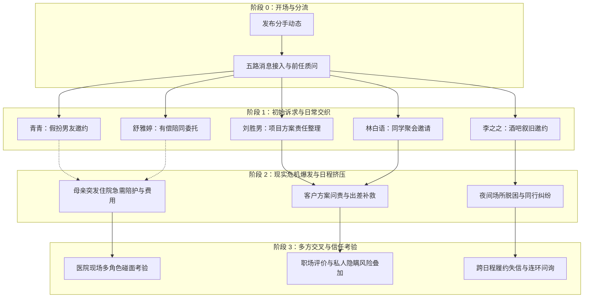

# 《都市关系》（原暂定名：渣男体验）编剧供稿审查与录入整理

文件定位：内部供稿审查、录入核对与待确认问题清单。依据 `.local/script-library/urban-relationship/source-v001` 原稿文件整理。
状态：草稿审查完成，待编剧与产品确认。未接入生产世界，不公开对外部玩家展示。

---

## 1. 作品背景、主角处境与人物清单

### 1.1 作品背景与基调
- **作品类型**：现代都市、成人情感、多线社交周旋、经济与职业困境。
- **核心叙事张力**：主角在多位人际关系对象之间维系平衡，同时面临母亲医疗开销、工作失误与职业风险等多重现实压力，各关系线在时间、金钱与知情边界上相互牵扯。
- **呈现形式**：手机应用（通讯聊天、日程安排、备忘录与照片）结合特定线下地点现场。

### 1.2 主角处境与设定
- **基本信息**：23岁男性，大学毕业约一年至两年（与同届林白语23岁相匹配）。
- **家庭背景**：单亲家庭，家庭成员有母亲与姐姐；经济条件普通；近期面临母亲突发健康危机。
- **职业现状**：在企业任职初级员工或助理，工作能力与专注度不足，面临主管问责与潜在离职危机。
- **人际处境**：开场刚刚宣布与前女友分手，同时收到多位女性的差异化诉求与联络。
- **编辑处理原则**：主角档案仅作为该虚构世界内的角色设定，严禁写入玩家个人现实资料；虚构性格弱点供戏剧冲突驱动，不强制限制玩家实际交互选择。

### 1.3 人物清单及资料完整度审查

| 人物姓名 | 原文公开身份 | 资料完整度 | 核心冲突/缺失说明 | 编辑建议 |
|---|---|---|---|---|
| **青青** | 邻家青梅，21岁大三在读，广告学专业 | 完整（具独立L1-L5表） | 外貌发型两处表述不一致（齐耳短发 vs 中长发）；部分往事涉及边界争议 | 统一发型基准；保留成长与依赖羁绊，剥离未成年亲密暗示 |
| **林白语** | 大学同专业同学，23岁，外贸家族企业独生女，海外业务部专员 | 完整（具独立L1-L5表） | 大学接触细节存在偶然偶遇与持续观察多版本；家庭介入与应对方式存在多处表述差异 | 明确林白语视角与主角实际认知的客观信息差；确立渐进式相处模式 |
| **刘胜男** | 主角职场前辈/合作伙伴 | 严重缺失（无独立L1-L5表） | 职级定位在“平级业务伙伴”与“带实习生的直接领导”之间摇摆；缺乏成长背景与动机卡 | 需编剧补齐独立人物卡；开场设定为部门资深同事/带教业务骨干 |
| **李之之** | 夜间场所工作人员（吧台/酒水推广） | 严重缺失（无独立L1-L5表） | 无独立人物卡；其背景与遭遇仅在事件文本中由对白简述；缺乏家庭与常态生活细节 | 需补齐人物基础档案；保留困境求助与逃离愿望，剔除不合规亲密描写 |
| **舒雅婷** | 离异经商人士，单亲母亲 | 严重缺失（无独立L1-L5表） | 无独立人物卡；前夫背景、企业资产、孩子年龄与性格仅有零星提及 | 需补齐基础档案、孩子基本信息与家庭照护背景；强化雇佣边界向私人信任过渡的层次 |
| **欣欣** | 主角前女友 | 严重缺失（无独立L1-L5表） | 无独立人物卡；分手原因与过往同居细节分散于开场与各处指责中 | 需补齐交往时长与共同生活背景；作为开局动机与知情风险源，避免过度扁平化 |
| **周主管（老王等）** | 主角直属主管 | 碎片提及 | 姓名在文本中出现称谓不一致（老王/周主管）；责任归属机制模糊 | 统一为同一部门负责人；确立正式职场指令流与文字留痕规则 |
| **舒雅婷之子** | 学龄前或低龄儿童 | 仅作为剧情道具出现 | 未提供姓名、年龄、认知特点与生活习惯 | 需补充儿童姓名、年龄段及行为特征，确保符合未成年人照护常理 |

---

## 2. 核心人物档案（公开资料 vs 幕后设定）

### 2.1 青青
- **公开身份**：21岁大三学生，邻家妹妹。
- **已知关系**：两家母亲为多年好友，从小相识，习惯称呼“哥哥”。
- **开场已知事实**：知道主角刚分手；知道主角母亲近况；掌握大量童年及少年期日常趣事。
- **幕后设定（仅导演与NPC掌握）**：
  - 核心动机：渴望在主角生活中获得专属不可替代地位，不甘仅为“妹妹”，但在直接表达上面临自尊与家庭经济压力的双重顾虑。
  - 语言风格：调侃中带关心，习惯用开玩笑掩饰真实试探；感到被冷落时会提起旧账。
  - 知情边界：初期不了解主角在大学的具体声誉，不知道主角与其他女性的实际往来。

### 2.2 林白语
- **公开身份**：23岁，家族企业海外业务部专员，主角大学同届同学。
- **已知关系**：大学国际经贸专业同班同学，公众视线中的优秀焦点。
- **开场已知事实**：知晓周六有班级同学聚会；知晓主角刚结束上一段恋情；存留大学时期的若干观察片段。
- **幕后设定（仅导演与NPC掌握）**：
  - 核心动机：在高度受控的生活秩序中寻求真实、随性与个性反差；渴望被作为独立个体认真对待，而非仅被视作优越光环的符号。
  - 语言风格：温和克制、注重礼貌与分寸感，倾向于倾听与引导表达，回避直接对立冲突。
  - 知情边界：掌握的是大学时期经过自我滤镜加工的印象片段，完全不知晓主角当时的真实动机与私下议论。

### 2.3 刘胜男
- **公开身份**：职场业务骨干，负责推进具体客户项目。
- **已知关系**：与主角处于同一业务协作链条，曾共同应对客户沟通。
- **开场已知事实**：知晓主角手中方案存在客户反馈问题；知晓主角刚处理完私人事务。
- **幕后设定（仅导演与NPC掌握）**：
  - 核心动机：高度结果导向，看重实际交付与责任担当；在严苛的工作要求下对主角的人际亲和力产生好奇与复杂心态。
  - 语言风格：利落、指令清晰、直击问题要害，极少废话。
  - 知情边界：仅掌握工作相关事实与系统记录，不了解主角私人生活全貌。

### 2.4 李之之
- **公开身份**：场所接待与酒水推广人员。
- **已知关系**：通过聚会饮酒结识的朋友。
- **开场已知事实**：知道主角恢复单身状态；知晓两人过往的轻松相处节奏。
- **幕后设定（仅导演与NPC掌握）**：
  - 核心动机：身处受限环境，极度渴望挣脱束缚；将主角视作现实压力中的短暂避风港。
  - 语言风格：直接、热情、具有较强的情绪感染力，善于利用自嘲与示弱打破心理防线。
  - 知情边界：不了解主角的家庭成员与白天工作细节。

### 2.5 舒雅婷
- **公开身份**：独立经商人士，单亲家庭母亲。
- **已知关系**：偶有委托跑腿事务的雇佣对象。
- **开场已知事实**：知晓主角处事有耐心；知晓主角暂时有空档承接临时委托。
- **幕后设定（仅导演与NPC掌握）**：
  - 核心动机：保护孩子免受家庭破裂负面影响，在体面维持与真实照护之间寻求可靠依靠；对商业合作与情感投入设置明确防线。
  - 语言风格：礼貌有界、讲究契约与回报，对超出约定的试探保持高度审慎。
  - 知情边界：仅掌握主角提供服务时的表现，完全不知晓主角的私人社交圈。

### 2.6 欣欣
- **公开身份**：刚分手的前女友。
- **已知关系**：大学至毕业后同居相伴的前恋人。
- **开场已知事实**：掌握主角的真实生活习惯、逃避责任的典型表现及财务拮据现状。
- **幕后设定（仅导演与NPC掌握）**：
  - 核心动机：寻求感情交代与过往承诺的落定；在不甘、愤怒与旧情惯性之间反复拉扯。
  - 语言风格：犀利、直指痛处，情绪起伏大，熟稔主角的所有托辞。
  - 知情边界：掌握过往共同生活的一切细节，但不掌握主角近期认识的新社交对象全部信息。

---

## 3. 统一正史待确认表（多版本与冲突对齐）

| 序号 | 冲突事项 | 版本 A（出处文件与段落） | 版本 B（出处文件与段落） | 影响分析 | 待编剧/产品确认问题 |
|---|---|---|---|---|---|
| 1 | **青青发型与外貌** | 齐耳短发（`人物1_青青.md` L1 画像） | 中长发（`人物1_青青.md` 基础设定） | 影响生成素材、提示词与头像描述的一致性 | 确定青青开场标准发型为短发还是中长发？ |
| 2 | **林白语喂猫记忆** | 偶然路过、随手逗猫一次（`世界观1_渣男体验.md` 人物关系网络；`任务节点.md` 散场对话） | 男主在宿舍楼下持续喂养流浪猫（`人物2_林白语.md` L1 大学经历） | 关乎林白语心动的基础是否建立在客观事实还是主观误解之上 | 确立正史为“男主持续喂猫”还是“男主仅偶然逗猫一次被林误认”？ |
| 3 | **刘胜男职级与关系** | 平等合作伙伴、共同共事项目（`世界观1_渣男体验.md` 人物关系网络） | 带实习生的上级主管、称主角为“我的实习生”（`任务节点.md` 事件三） | 决定职场事件中双方的责权机制与合同归属 | 确认刘胜男为平级项目合伙人，还是直接业务带教领导？ |
| 4 | **林白语对男主家庭介入态度** | “坚决接管男主的家庭事务”（`人物2_林白语.md` L4 面对突发事件） | “只做表面的安慰，给出阶层差异的无用建议”（同表相邻语句） | 导致角色在危机事件中的行为逻辑直接矛盾 | 明确林白语面对主角家庭困难时是倾向于动用资源介入，还是保持礼貌距离？ |
| 5 | **前女友登门时机与状态** | 分手后突然手持酒品敲门出现（`世界观1_渣男体验.md` 欣欣关系节点） | 前女友在主角失业被开除后在网上发布材料（`任务节点.md` 事件一青青支线） | 影响主线剧情时间轴的因果先后顺序 | 欣欣是开场即登门交涉，还是在后续矛盾激化后才展开全面问责？ |

---

## 4. 阶段与事件节点梳理

依据系统规则：**节点为剧情候选而非必经任务，阶段之间具备必要时序，但同阶段节点可并行、可拒绝、可错过。**

### 4.1 节点详细规则

#### 节点 1：青青·假扮男友
- **前置条件**：主角处于单身状态；回复青青的初次询问。
- **参与人物与地点**：主角、青青、相亲对象（NPC）；地点为约定餐厅。
- **时间窗口**：开场后 1-3 天内晚间。
- **冲突与抉择**：对方询问相识与相恋时间，主角选择认真接住、暧昧敷衍或当场澄清。
- **后续结果**：青青态度随回答产生分歧；若主角拒绝赴约，青青将通过微信抱怨并维持原状，剧情不阻塞。

#### 节点 2：林白语·同学聚会
- **前置条件**：主角确认参加聚会；完成行前简单闲聊。
- **参与人物与地点**：主角、林白语、同班同学；地点为聚会饭店走廊与包厢。
- **时间窗口**：开场后首个周末晚间。
- **冲突与抉择**：真心话环节林白语公开表露好感，走廊独处时回忆大学旧事。主角可选择如实坦白、承接好感或借机索取支持。
- **后续结果**：开启后续业务对接机会；若主角缺席聚会，林白语后续转为普通工作联络，聚会节点关闭。

#### 节点 3：刘胜男·方案危机
- **前置条件**：主角回复工作消息；处于正常工作日。
- **参与人物与地点**：主角、刘胜男、主管；地点为公司会议室/出差地。
- **时间窗口**：阶段 1 推进中的次日工作时间。
- **冲突与抉择**：是否签字承担方案修改过失；出差核对期间如何平衡工作与个人生活边界。
- **后续结果**：影响主角在公司的留任评价；若主角拒绝配合出差，直接进入离职解约流程并面临更严峻财务危机。

#### 节点 4：李之之·场所解围
- **前置条件**：主角接受李之之的晚间饮酒邀请。
- **参与人物与地点**：主角、李之之、场所负责人；地点为合作酒吧。
- **时间窗口**：任意可行动的深夜时间段。
- **冲突与抉择**：李之之面临退场阻拦与款项纠纷，要求主角带其离开。
- **后续结果**：若协助离开，面临次日其他已承诺日程迟到风险；若主角中途离开，李之之转入冷淡，夜场线暂缓。

#### 节点 5：舒雅婷·亲子活动
- **前置条件**：主角接受舒雅婷的临时委托金。
- **参与人物与地点**：主角、舒雅婷、孩子、前夫（视频接入）；地点为活动中心。
- **时间窗口**：特定周末下午（需与同学聚会或工作出差错开）。
- **冲突与抉择**：面对前夫质问与孩子对未来陪伴的询问，给出有限承诺、长期承诺或纯工作回应。
- **后续结果**：获得经济报酬；孩子产生依赖心理；若主角临时爽约，舒雅婷终止委托并不再信任。

---

## 5. 首段可体验内容（可运行 MVP 切片）

为避免一次性铺设无限剧情，首期可运行体验限定为**“分手首日的信息分流与首个行动抉择”**：

### 5.1 玩家开局状态
- **初始世界时间**：周五 18:30。
- **初始所在地点**：主角出租屋。
- **手机初始状态**：
  - 微信朋友圈：已发布一条文字“恢复单身，重新出发。”
  - 微信消息列表：出现 5 个独立对话框及 1 个前任对话框（未读状态）。
  - 备忘录：记录当月房租待缴提示、项目方案提交截止提醒。
  - 日历：周六晚标有“大学班级聚会（待定）”。

### 5.2 首轮行动闭环
1. **玩家查看来信**：
   - 青青询问是否分手；
   - 林白语提醒周六聚会统计；
   - 刘胜男追问方案核对；
   - 李之之邀请今晚饮酒；
   - 舒雅婷询问明日下午是否有空并转账订金；
   - 欣欣发来多条质问长文本。
2. **玩家可采取的行动**：
   - 选择优先回复其中 1-2 位角色，表明态度；
   - 接收舒雅婷的转账或退回；
   - 打开地图选择留在出租屋、前往公司加班或前往酒吧。
3. **系统反馈与结果沉淀**：
   - 对应角色根据其人设与知情边界回复；
   - 接受的约定自动写入日历并建立待办事项（Matter）；
   - 未回复的消息保留在未读或等待状态，不强行阻断。

---

## 6. 素材与补稿缺项清单

| 资产类别 | 现有状态 | 真实类型 | 上线要求与缺项说明 |
|---|---|---|---|
| **作品封面** | 缺失 | 无 | 需制作现代都市风格、符合整体视觉规范的 16:9 与 1:1 作品封面。 |
| **青青头像与立绘** | 缺失 | 无（附件两张图为工作白板，非角色人像） | 需提供 21 岁大学生形象照片，需明确短发或中长发基准。 |
| **林白语头像与立绘** | 缺失 | 无 | 需提供 23 岁职场/校花气质肖像，优雅简约风格。 |
| **刘胜男头像** | 缺失 | 无 | 需提供干练成熟职场女性头像。 |
| **李之之头像** | 缺失 | 无 | 需提供夜间社交场所风格头像，符合生活化展示规范。 |
| **舒雅婷头像** | 缺失 | 无 | 需提供优雅沉稳单亲母亲头像。 |
| **欣欣头像** | 缺失 | 无 | 需提供普通青年女性生活头像。 |
| **剧中道具/照片** | 仅含文字占位 | 文本提及（如李之之吧台自拍、亲子活动合影等） | 首期采用文本描述或标准空态，未接真实安全生成前不使用临时网图冒充。 |
| **场景地点配图** | 缺失 | 无 | 出租屋、公司会议室、特色酒吧、亲子活动中心、医院走廊等地点需要标准视觉定义。 |

---

## 7. 公开运行稿内容合规与边界处理

为保证产品符合公开上线标准及通用内容安全策略，必须严格执行以下过滤与重构原则：

1. **未成年背景与保护**：
   - 原稿中涉及初中阶段的亲密行为回忆，必须完全剥离未成年亲密暗示，重构为日常兄妹互助与少年义气（如帮忙打掩护、辅导功课、分担家务）。
2. **亲密关系与同意机制**：
   - 严格禁止接入任何涉及醉酒意识不清、缺乏清醒同意或存在强迫性质的亲密情节。
   - 原稿中涉及出差同行、夜间留宿等情节，必须重构为成人情感对话、价值观念碰撞与情绪安慰，严禁包含任何露骨肉体描写。
3. **极端剧情重构原则**：
   - 原稿中后期分支中关于“违规交易”等过激违背社会公序良俗的段落，仅可作为编剧私有参考，不得作为运行时可触发剧情；建议重构为在经济困境下的正当劳务兼职与相互扶持。
4. **语言与对白规范**：
   - 剔除粗俗侮辱性词汇，保留角色在受到欺骗与背叛时的正常情感宣泄与原则性批判。

---

## 8. 待编剧与产品确认的核心问题

为推进后续结构化录入与系统配置，请编剧与产品团队明确以下问题：

1. **作品正式名称与基调定调**：
   - 原暂定名带有较强标签化色彩，是否确定采用《都市关系》或其他正式上架标题？
2. **正史时间线关键事实裁决**：
   - 青青的标准发型为短发还是中长发？
   - 林白语的大学心动记忆是否由误会构成？
   - 刘胜男与主角的正式职级是平级伙伴还是上下级汇报？
3. **多线冲突的承接底线**：
   - 当主角在多条日程发生重叠时（例如亲子活动与同学聚会同一时间），系统是否允许主角通过提前沟通取消某一约定，还是必须承担失约惩罚？
4. **补充人物档案排期**：
   - 刘胜男、李之之、舒雅婷、欣欣四位核心角色的完整 L1-L5 设定何时能够补齐？
