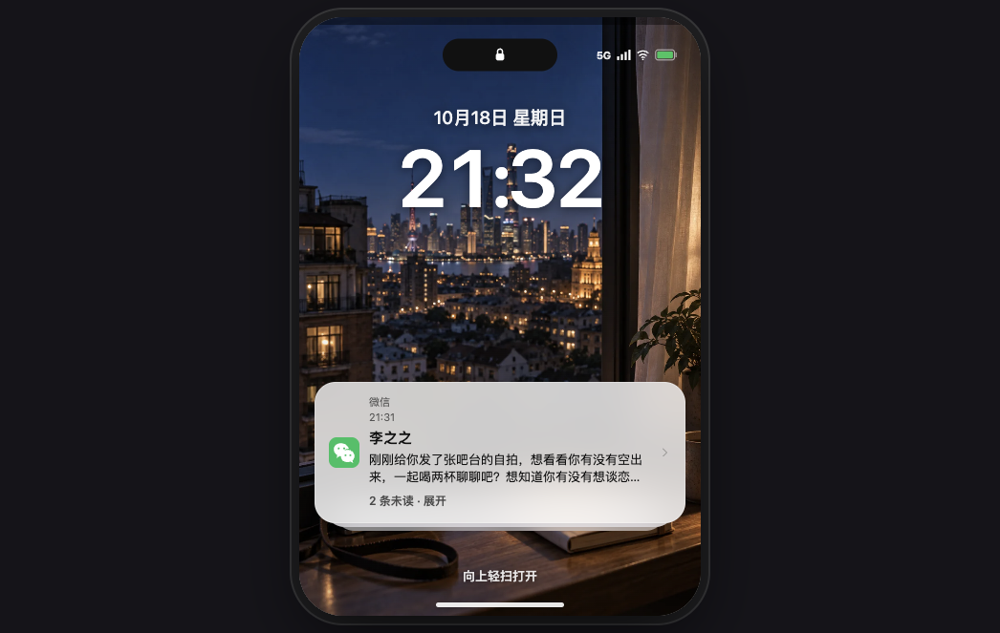

# 44-182 NPC 本地主动推进

## 已完成

- 新增 `actor_local` 候选来源：owner 一段时间没有操作时，直接唤醒最近相关 NPC，不经过导演审批。
- 只用一个人物，避免多 actor 触发全局导演协调。
- 90 秒 idle 阈值，最后一次 NPC 消息后 30 分钟冷却，防止连续刷消息。
- NPC 仍自主决定主动、等待或安静；不是预制台词。
- 修复 strict response_format：
  - `conditions` 必须保留在 required；
  - `nextStep` 必须保留；
  - 所有对象属性重建 required；
  - 这是上游 400 的真实根因。
- 导演仍负责低频全局任务；local initiative 不依赖导演。

## 真实生产验证

- 现有渣男体验世界真实产生新 NPC 消息：
  - 李之之；
  - 版本 7→8；
  - 消息 80→81；
  - text：`刚刚给你发了张吧台的自拍，想看看你有没有空出来，一起喝两杯聊聊吧？想知道你有没有想谈恋爱的心情。`
- PhoneShell 锁屏读取到该消息：
  - `2 条未读`
  - 李之之
  - 真实时间 21:31。
- 之后立即再次 advance 产生了重复消息（81→83），暴露冷却缺失。
- 已加 30 分钟 lastAssistantAt 冷却；部署后立即 advance 复测：version 13、messages 83 保持不变，不再重复。

## 锁屏截图

## 验证

- full check 3892/3892
- build 通过
- Production `45d68589` / `dpl_is5zic8qf`；冷却已部署；立即 advance 不重复。

## 边界

- 当前消息是 local initiative，不是导演任务；
- 导演任务链路此前已产出 opportunity，但 actor schema 400 被同一修复解决；
- 冷却复测后才算完整验收。
