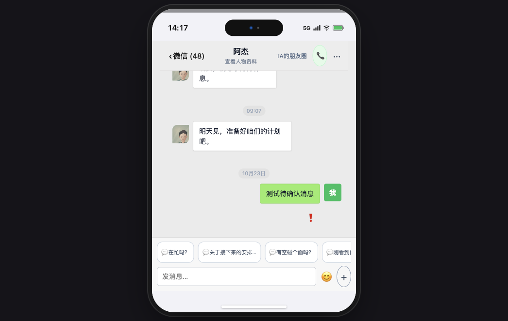

# 44-195 未知结果不再冻结输入、主动质量与本地主动稳定性

日期：2026-10-23。负责人 dsh-final-loop-20261023；root 唯一集成。生产域名
`https://parallel-world-eosin.vercel.app`，最终业务提交 `8f625c5c`（本报告随后
的文档提交单独记录）。

## 1. 未知结果后的输入冻结

根因：'发送结果待确认' 的本地消息同时被当成输入框的全局禁用条件；后台核对只能
读取/恢复，无法把真正 unknown（上游没有 response/event）变成已知结果，所以一次
unknown 会永久禁用整个聊天输入。

修复：

- `hasInFlightLocalSend` 只让仍处于 `pending` 的本轮发送阻塞输入；`unknown` 继续
  显示原消息和核对按钮，但不再占用输入框。
- 未知消息的核对按钮先 lookup；只有服务端返回 `response_received` 时才调用
  `/messages/recover`，绝不自动重发或重新购买模型。
- 核对仍未命中时明确提示“原消息仍保留，可以先继续聊天”，不再暗示会自动重试。

真实生产 UI 验证（`县城黄毛`，真实 owner 会话，只读服务端；本地临时注入一条
unknown 作为浏览器状态，随后清理）：

- 聊天列表能看到待确认消息；
- 打开对应私聊后输入框 `disabled=false`；
- 页面仍有“发送结果待确认，点按核对”按钮；
- 没有向服务端写入测试消息。

## 2. 主动消息质量

新增并上线以下内容过滤（仅私有 `wake`/`coordination` 主动路径）：

- `继续观察着，等有啥具体情况了再说`
- `我看着还行，暂时没有什么要特别做的`
- `今晚先这样，等时机成熟再说吧`
- 原有“整理好了心情/没什么要补充/确保没遗漏”等空计划句。

新建独立 guest 世界 `e1642bb2-f6b7-4730-8de1-491e310daf04`，在最终代码上执行
真实开场（2 次 actor 调用）：

- 一条空 statement 被安全提交为安静；
- 一条具体内容：“刚刚想起妈妈的事，心里一直揪着，还是赶紧去看她比较好。”；
- 没有出现“今晚先这样/继续观察”类空计划句。

这证明开场质量闸门已在真实模型路径生效。`pg_cron` 的下一次真实定时样本仍受
当日预算/时间窗限制，不能把本样本冒充定时 tick。

## 3. 本地主动：一个真实 30 分钟冷却，一个批次只发一人

发现并修复两个独立问题：

1. 之前用 story clock 的 30 分钟与 real clock 的 10 分钟“任一满足”放行；12x
   故事时钟下约 2.5 真实分钟就能再次主动。现在只用 **真实 30 分钟** 冷却，
   故事时钟加速不能绕过。
2. 一次 `advance` 会在每个调度步骤重新收集候选，连续给多个 `actor_local` 发消息。
   批次上下文新增 `markLocalInitiative/localInitiativeStarted`，一批只允许一个
   `actor_local`；其他人物仍可执行自己的 plan/responsibility。

真实 guest 世界 `350e8356-0198-401a-a30c-a624c1b24d33` 证据：

- `clock/wait` 推进后 `advance`：`played:1`，只有 `actor_local` 舒雅婷；
- 再次 `advance`：`played:0`，没有新的本地主动；
- 修复后本地主动文本为具体安排：“我已经把明天的看孩时段都安排好了……”。

本次仍保留人物自己的 `quiet` 权利，不强制每个 tick 发消息。

## 4. 导演显式复查与已知失败 episode

- `forceDirectorReview` 之前即使零 actor 候选也会被“有本地候选”挡住；现在显式
  owner 复查会真正调用导演，返回后仍由导演决定 quiet/机会。
- 生产 `渣男体验副本` 上，强制复查创建了真实导演 attempt
  `29b31375-47d9-4a67-8c26-34edd98b5e1d`；导演选择 quiet，没有伪造消息。
- `director/dispatch` 对“已有 known invalid paid evaluation”的 episode 之前直接
  返回 null；现在只能由显式 owner dispatch 用新的 fresh command 退休该已知无效
  attempt，unknown/paid success 仍被围栏。eligibility 单测 70/70 通过。

## 5. 仍未完成 / 不冒充

- 显式 dispatch `渣男体验副本` 的 `episode_request:8fb81c...` 后，actor 模型已经
  产生响应，但提交仍返回 `VERSION_CONFLICT`，attempt 被保留为
  `stale_discarded`（有 response、无 event/message）。没有把这次调用算成导演派发
  成功，也没有自动重试或重买。
- 进一步在本地用该 saved response 重放：lease 已过期时首先得到
  `ATTEMPT_STALE`；尝试把 attempt 状态恢复为 `response_received` 再提交时，被数据库
  `AGENT_RECOVERY_REQUIRED` 触发器拒绝，不能用人工改状态绕过。原始提交失败的具体
  冲突类型仍未被安全观测到，因此不能声称已修复。
- 该残留说明 actor 当前 projection 与 world version 的 stale 修复仍未闭环；
  44-181 继续保留进行中。
- 主动质量的下一次 `pg_cron` 真实 tick 仍需观察；本次只证明新开场与单测路径。
- 旧域名/其他 Agent 的 `pl_app` 兼容仍按用户要求暂缓。

## 验证

- 聚焦测试：`chat-send-error`、`proactive-quality`、`agent-schedule-collectors`、
  `agent-advance-batch`、`agent-episode-dispatch-eligibility` 全部通过。
- 最终全量 `npm run check`：`3927/3927` 通过；`npm run build`：31/31 路由通过。
- 生产 `/api/health` 200；无新 SQL 迁移。
